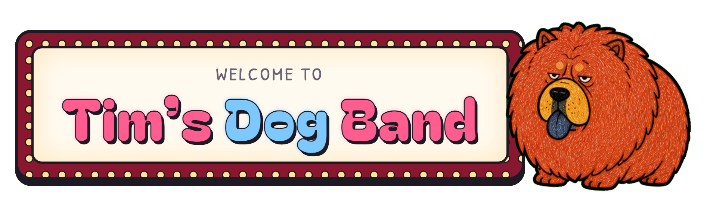

  

  <a href="https://ruiling-smartbear.github.io/tims-dog-band/"><b>▶ Open the stage</b></a>

I love dogs, so I designed a whole crowd of strange ones: wrinkly ones, fluffy ones, grumpy ones, ones that look like a mop. Twelve of them formed a band.

Tap the sign to turn on the lights. The dogs walk on stage half asleep, and each one you tap wakes up and joins in on its instrument.

## The band

| Dog | Plays |
| --- | --- |
| Wrinkles | 🪗 accordion |
| Mint | 🎻 violin |
| Grumbles | 🎺 trumpet |
| Pumpkin | 🥁 drum |
| Lavender | 🎸 guitar |
| Wingnut | 🪇 maracas |
| Mop | 🎹 keys |
| Duchess | 🎷 sax |
| Bruiser | 🪘 bongos |
| Blueberry | 🪈 flute |
| Fuzz | 🪕 banjo |
| Big Leo | harp (he shows up in the later rounds) |

## How it's made

Everything is one file, [`index.html`](index.html): no build step, no dependencies. The dogs are embedded as images, and all the music is synthesized live in the browser with the Web Audio API. Each dog has its own track, and the tune goes through five rounds of variations.

To run it locally, just open `index.html` in a browser.

## License

[MIT](LICENSE): the code and the dog drawings are free to use.
